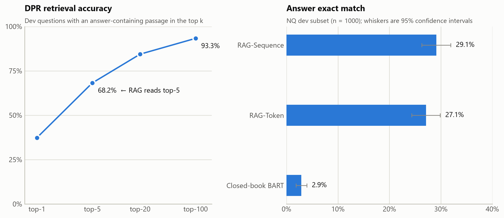

# RAG + DPR reproduction

A small-scale reproduction of two papers on open-domain question answering:

- **DPR**: Karpukhin et al., 2020, *Dense Passage Retrieval for Open-Domain Question Answering*
- **RAG**: Lewis et al., 2020, *Retrieval-Augmented Generation for Knowledge-Intensive NLP Tasks*

A BERT bi-encoder (DPR) retrieves passages, and BART generates the answer from them. Both RAG variants are implemented (RAG-Sequence and RAG-Token), along with a closed-book BART baseline that answers without retrieval.

## Results

Natural Questions, 1,000 dev questions. EM = exact match after SQuAD-style normalisation.

| | DPR 10 epochs | DPR 3 epochs | Paper |
|---|---|---|---|
| DPR top-1 | 37.3% | 35.8% | — |
| DPR top-5 | 68.2% | 64.1% | — |
| DPR top-20 | 84.4% | 82.3% | 78.4% |
| DPR top-100 | 93.3% | 92.3% | 85.4% |
| RAG-Sequence EM | 29.1% | 28.0% | 44.5% |
| RAG-Token EM | 27.1% | 26.3% | 44.1% |
| Closed-book BART EM | 2.9% | 2.5% | — |



*Figure: the 10-epoch DPR run.*

- **Retrieval drives the result.** RAG scores about 25 points above closed-book BART with the same generator and training data.
- **RAG-Sequence vs RAG-Token is a tie.** The gap (about 2 points) is within noise: the 95% confidence interval is about ±2.8 points at n = 1,000.
- **Longer DPR training helps retrieval slightly but not RAG.** DPR's training loss reaches about 0 by epoch 3. Training to 10 epochs still raises retrieval accuracy by 1–4 points (most at top-5), but RAG's EM changes by only about 1 point, which is within noise.

The numbers are not directly comparable to the papers:

| | This repo | Papers |
|---|---|---|
| Corpus | 842k passages (those attached to the sampled questions) | 21M Wikipedia passages |
| Training questions | 10k | ~79k |
| Generator | `bart-base` | BART-large |

The corpus contains every dev question's gold passage, which makes retrieval easier than in the papers.

## Pipeline

| Step | Command | Output |
|---|---|---|
| 1. Data | `python -m ragdpr.prepare_data` | `data/nq/{train,dev,passages}.jsonl` |
| 2. Train DPR | `python -m ragdpr.dpr.train --epochs 3 --fp16` | `checkpoints/dpr/` |
| 3. Build index + retrieval eval | `python -m ragdpr.dpr.index --build --eval` | `checkpoints/index/index.faiss` |
| 4. Train RAG | `python -m ragdpr.rag.train --variant {seq,token} --fp16` | `checkpoints/rag_{seq,token}/` |
| 5. Train closed-book baseline | `python -m ragdpr.closed_book --fp16` | `checkpoints/closed_book/` |
| 6. Evaluate | `python -m ragdpr.rag.evaluate --variant {seq,token}`<br>`python -m ragdpr.rag.evaluate --no_retrieval` | `results/results.json` |
| 7. Plot | `python -m ragdpr.plot` | `figures/results.png` |

Run every command from the repo root. Steps 2–6 need a GPU. [`notebooks/rag.ipynb`](notebooks/rag.ipynb) runs the whole pipeline on Colab and keeps checkpoints and results on Google Drive.

Useful flags:

| Flag | Script | Effect |
|---|---|---|
| `--limit N` | evaluate | evaluate the first N dev questions only |
| `--n_docs K` | train, evaluate | retrieve K passages per question (default 5) |
| `--predictions_out FILE` | evaluate | write each question, its gold answers and the prediction to JSON |
| `--max_steps N` | all training scripts | stop after N steps, for quick tests |

Paths, model names and hyperparameters are in [`ragdpr/config.py`](ragdpr/config.py).

## Setup

```
pip install -r requirements.txt
```

Data comes from [`Tevatron/wikipedia-nq`](https://huggingface.co/datasets/Tevatron/wikipedia-nq) on Hugging Face.


## Implementation notes

- **DPR training:** in-batch negatives plus one hard negative per question, so a batch of B questions is scored against 2B passages.
- **Index:** exact inner-product search (`faiss.IndexFlatIP`).
- **RAG training:** the passage encoder and index stay frozen. Passage scores are recomputed from the stored vectors, so the question encoder still gets gradients.
- **RAG-Sequence decoding:** "thorough decoding". It beam-searches with each passage separately, then rescores every candidate answer against all k passages.
- **RAG-Token decoding:** greedy decoding over the next-token distribution, combined across the k passages. The paper uses beam search here.
